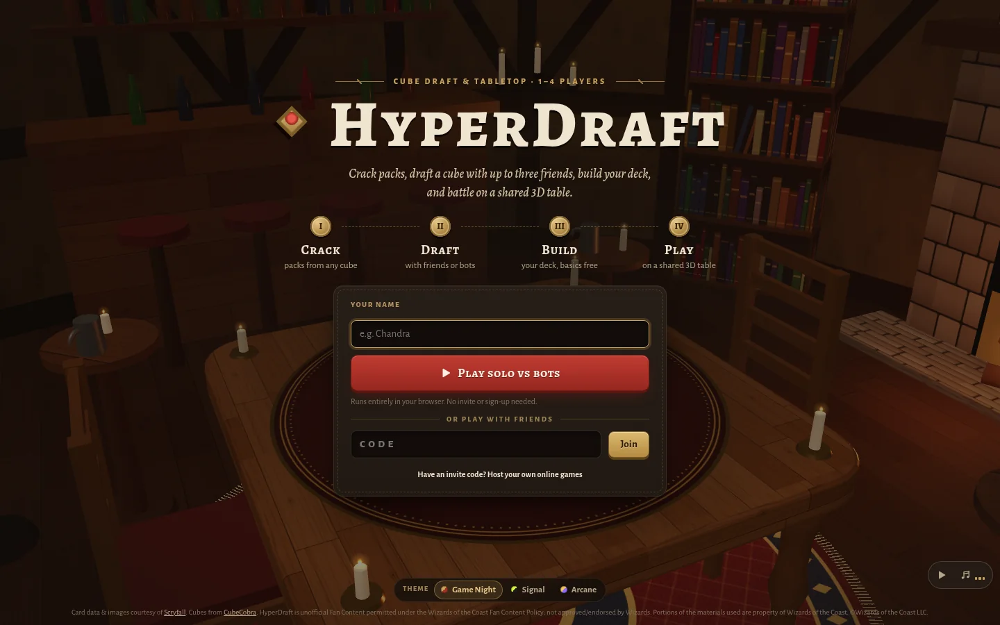
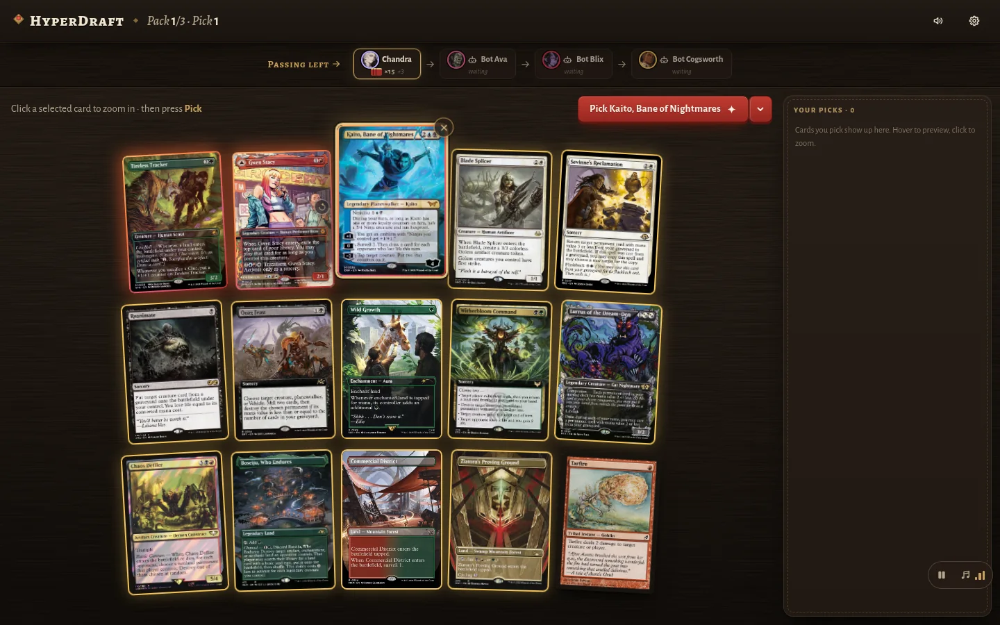
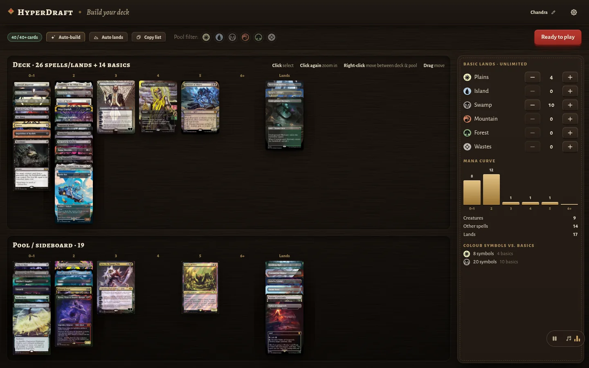
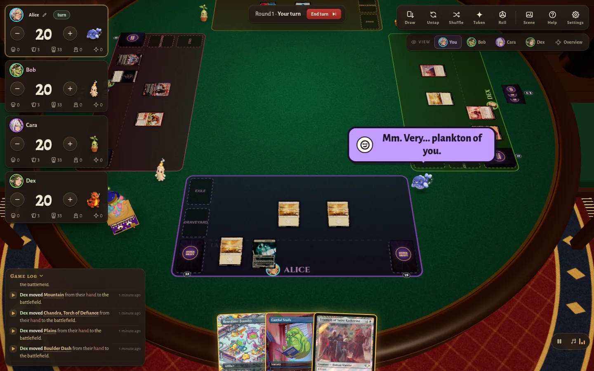
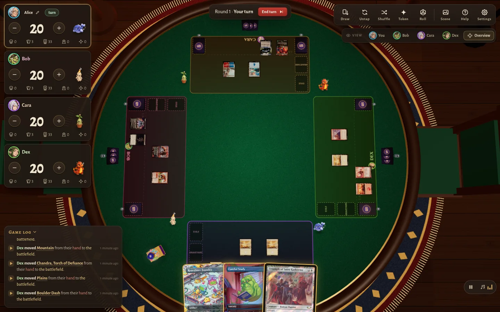
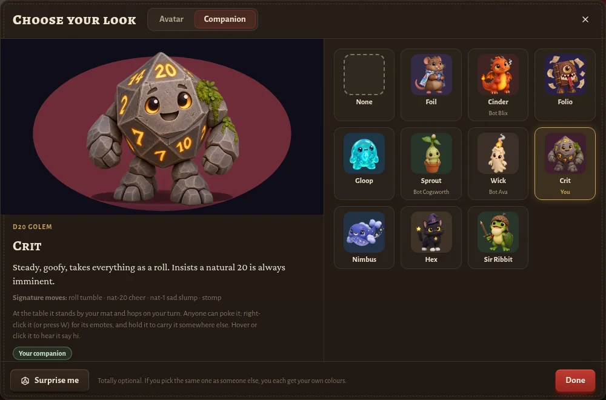

#  HyperDraft

[](https://github.com/crcatala/mtg-hyperdraft/actions/workflows/ci.yml)
[](LICENSE)

**Crack packs, draft a cube with up to three friends, build your deck, and battle on a shared 3D table,
all in the browser.**

HyperDraft is a Magic: The Gathering cube drafting app with a freeform 3D tabletop. Play solo against
bots with nothing to install and no sign-up, or host your own private rooms for friends on Cloudflare's
free tier.

> [!NOTE]
> **Unofficial fan project.** HyperDraft is unofficial Fan Content permitted under the
> [Fan Content Policy](https://company.wizards.com/en/legal/fancontentpolicy). Not approved/endorsed by
> Wizards. Portions of the materials used are property of Wizards of the Coast. ©Wizards of the Coast LLC.
> HyperDraft is free, and isn't affiliated with Wizards of the Coast, Scryfall or CubeCobra.

<p align="center">
  
</p>

## Features

- **Draft any cube.** Paste a CubeCobra link or a card list, draft a whole Magic set by name or code, or
  load the bundled 384-card Hypercube in one click. Card data comes from Scryfall.
- **Rip real-feeling packs.** Every pack is a 3D foil booster you tear open by dragging across the top,
  with light spilling out and the cards dealt face down, then flipped.
- **Draft with friends or bots.** Up to 4 players and 8 seats, with bot drafters, pick timers, burns and
  left-right-left passing.
- **Build fast.** A deckbuilder with unlimited basics, automatic lands from your mana symbols, one-click
  auto-build and a live mana curve.
- **Play on a shared 3D table.** Drag and drop, tap, flip, counters, tokens, scry, search, mulligans,
  dice, pings and a game log. Hidden information (hands, libraries, face-down cards) is enforced by the
  server, and the zoom view explains keywords and fetches official rulings.
- **Bring a companion.** Pick a character portrait and one of ten companions who stand by your mat,
  react to pokes, fire off emotes with voices and speech bubbles, and race each other for treats from
  the Treatomancer.
- **Set the scene.** Three tables, three environments (tavern, arcane library, moonlit grove), three UI
  themes, four sound packs and a background soundtrack.
- **Cheap to host.** The whole app is one Cloudflare Worker with Durable Objects, designed to stay inside
  the free plan.

## Screenshots

<p align="center">
  
</p>

<table>
  <tr>
    <td width="50%"></td>
    <td width="50%"></td>
  </tr>
  <tr>
    <td align="center">Drafting a fresh pack</td>
    <td align="center">Building a deck</td>
  </tr>
  <tr>
    <td width="50%"></td>
    <td width="50%"></td>
  </tr>
  <tr>
    <td align="center">A four-player game from your seat</td>
    <td align="center">The same game from overhead</td>
  </tr>
  <tr>
    <td colspan="2" align="center"></td>
  </tr>
  <tr>
    <td colspan="2" align="center">Choosing a companion</td>
  </tr>
</table>

## Quick start

### Play locally

You need [Node.js](https://nodejs.org/) 22 or newer (CI uses 24).

```bash
git clone https://github.com/crcatala/mtg-hyperdraft.git
cd mtg-hyperdraft
npm install
npm run dev          # http://localhost:3000
```

Open <http://localhost:3000>, enter a name and click **Play solo vs bots**, then **Quick start** to draft
the bundled Hypercube right away. Solo mode runs entirely in your browser.

`npm run dev` also runs the Worker and Durable Objects locally (no Cloudflare account needed), so you can
try online rooms too. The first run creates `.dev.vars` with a dev invite: open
<http://localhost:3000/?invite=dev-invite-key> once, then **Host an online game**. To play several seats
on one machine, open the room link in other tabs with `?as=2`, `?as=3`, and so on.

### Deploy to Cloudflare

You need a free [Cloudflare](https://dash.cloudflare.com/sign-up) account.

```bash
npx wrangler login                       # once: authorize Wrangler with your account
npm run deploy                           # build and deploy the Worker

# A key for signing room codes (save it in your password manager)
ROOM_CODE_SECRET=$(openssl rand -base64 32)
printf '%s\n' "$ROOM_CODE_SECRET"
printf '%s' "$ROOM_CODE_SECRET" | npx wrangler secret put ROOM_CODE_SECRET
unset ROOM_CODE_SECRET

# Who may host
npm run invite:new -- sam                # prints an invite entry (sam:<key>) and its magic link
npx wrangler secret put INVITE_CODES     # paste entries, comma-separated: sam:<key>,jo:<key>
```

Wrangler prints your site URL (e.g. `https://hyperdraft.<your-subdomain>.workers.dev`). Anyone can play
solo there. Send each friend who should be able to host their magic link, `<site URL>/?invite=<key>`.
See [Deploying to Cloudflare](docs/deployment.md) for the full walkthrough, invite management and the
optional public rooms.

## How rooms and invites work

- **Solo games** need nothing: no server, no invite, no account. Nothing is saved, so closing the tab
  ends the game.
- **Invite codes let people host.** The person who deploys HyperDraft lists invite keys in the
  `INVITE_CODES` secret. Opening a magic link (`/?invite=<key>`) saves the key in that browser, which can
  then host online rooms. Each invite can open 10 new rooms per 24 hours and keep 25 saved rooms; rooms
  idle for 90 days are deleted. Remove an entry from `INVITE_CODES` to revoke it.
- **Room codes let people join.** Every online room gets a 7-character code (like `G553JU9`) and a link
  (`/r/G553JU9`). Anyone with the code or link can join; no invite or account is needed to play. The
  last two characters are a signature made with `ROOM_CODE_SECRET`, so the Worker rejects made-up codes
  without waking a room's Durable Object. A room link works like a key: anyone who has it can join.
- **Seats are remembered.** Your browser remembers your seat in each room, so a refresh or a closed tab
  rejoins it. From another device, a started game lets you claim a seat nobody is using.
- **Public rooms (optional).** You can also let anyone host without an invite, from a small pool of rooms
  that close on their own: 3 at once, up to 3 hours each, and 12 room-hours of new rooms a day. They're
  off unless you turn them on, and they don't need `INVITE_CODES`. See [Public rooms](docs/deployment.md#public-rooms-optional).

## Configuration

Online play is configured with Worker secrets (`npx wrangler secret put <NAME>`). Locally they live in
`.dev.vars`, created from [`.dev.vars.example`](.dev.vars.example) on the first `npm run dev`.

| Secret | Default | What it does |
|---|---|---|
| `ROOM_CODE_SECRET` | none (required for online rooms) | Signs room codes. Changing it invalidates every existing room code. |
| `INVITE_CODES` | none | `label:key` pairs, comma-separated. Each key lets a browser host invite rooms. Not needed if you only use public rooms. |
| `ONLINE_ENABLED` | on | Kill switch: set to `false` to turn all online rooms off. Solo keeps working. Setting the secret redeploys the Worker, which disconnects everyone in a room. |
| `PUBLIC_ROOMS_ENABLED` | off | Set to `true` to let anyone host from the public room pool. |
| `TURNSTILE_SITE_KEY`, `TURNSTILE_SECRET_KEY` | unset | Adds a Cloudflare Turnstile bot check before hosting a public room, when both are set. |

## Hosting costs and Cloudflare limits

HyperDraft is designed to run for free on Cloudflare's Workers free plan. On the free plan, going over a
limit makes things stop working rather than sending you a bill:

- **Static files and card images don't count.** The client is served as static assets, and card images
  load straight from Scryfall's CDN. Only `/api/*` calls run your Worker, and each one counts toward the
  Workers daily request limit, including calls the Worker rejects: forged room codes, failed bot checks,
  and the home page's status checks.
- **Rooms sleep between moves.** Room websockets hibernate, the draft clock pauses when nobody is
  connected, and forged room codes are rejected without waking a Durable Object.
- **Every room is rate limited.** A room handles at most 10 messages/s and saves at most 1 change/s
  sustained. A room kept awake for a whole hour uses about 450 of the 13,000 GB-s daily Durable Object
  duration limit, however hard it's flooded. Messages it drops, reconnects and new connections still
  count as requests, and these figures are per room, so they add up when several rooms are busy at once.
- **Public rooms have a daily budget** of 12 room-hours of new rooms. Rooms opened late in the day can
  run past midnight UTC, so one UTC day can see up to about 21 public room-hours.

> [!WARNING]
> On the free plan, limits are hard caps, not bills. If any daily Durable Object limit, or the Workers
> request limit, is exceeded, every online room on your account stops working until the reset at 00:00
> UTC (solo mode keeps working). A few
> friends playing won't come close. If you open public rooms to the internet, consider Turnstile and a WAF
> rate-limiting rule, or the Workers Paid plan ($5/month), which turns the hard limits into small overage
> charges.

See [Costs and free-plan limits](docs/deployment.md#costs-and-free-plan-limits) for the worst-case
numbers behind these estimates and what they leave out.

## Documentation

- [Gameplay guide](docs/gameplay.md): drafting and imports, table controls, companions, the
  Treatomancer, scenes, themes and sound.
- [Deploying to Cloudflare](docs/deployment.md): setup, invites, public rooms, Turnstile, costs.
- [Development](docs/development.md): local setup, debug tools, tests, and how to add themes, tables,
  sounds, companions and music.
- [Architecture](docs/architecture.md): code map, the authoritative server, solo mode, flood control.

## Contributing and security

This is a personal project. Bug reports and ideas are welcome as GitHub issues, but pull requests
generally aren't accepted. See [CONTRIBUTING.md](CONTRIBUTING.md). To report a vulnerability, see
[SECURITY.md](SECURITY.md). Forks are welcome under the [MIT License](LICENSE).

## Credits

- Card data and images courtesy of [Scryfall](https://scryfall.com) (please respect their
  [API guidelines](https://scryfall.com/docs/api)); cubes from [CubeCobra](https://cubecobra.com).
- Mana symbols from the MIT-licensed [Mana font](https://github.com/andrewgioia/mana).
- Rules help shows short excerpts from the [MTG Wiki](https://mtg.wiki) (CC BY-NC-SA 4.0, credited and
  linked in place) and never copies the Comprehensive Rules.
- Background music (`public/music/`) was generated with [Suno](https://suno.com); the files carry Suno's
  C2PA provenance metadata. Suno's terms for generated tracks depend on the plan they were made under, so
  check the current terms before using them commercially or redistributing them outside this free project.
- Sound effects and companion voices were generated with
  [ElevenLabs](https://elevenlabs.io/docs/api-reference/text-to-sound-effects/convert).
- Avatar and companion art is AI-generated (prompts in `scripts/roster/roster.json`); treat art was
  generated with GPT Image.

Magic: The Gathering is a trademark of Wizards of the Coast LLC. Keep it free: don't paywall or monetize
anything built on this data.

## License

HyperDraft's source code is available under the [MIT License](LICENSE). The license covers this
project's own code. Card data, card images and Magic: The Gathering intellectual property belong to their
owners, and the third-party data, fonts, music and other generated assets keep the terms described in
[Credits](#credits).
